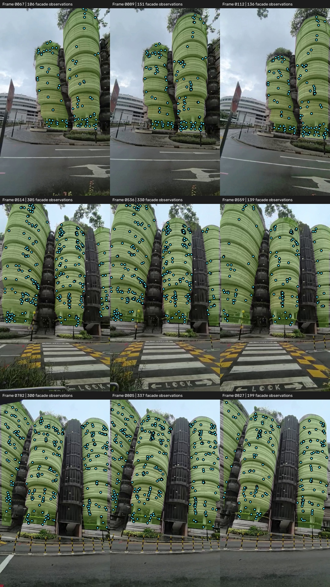
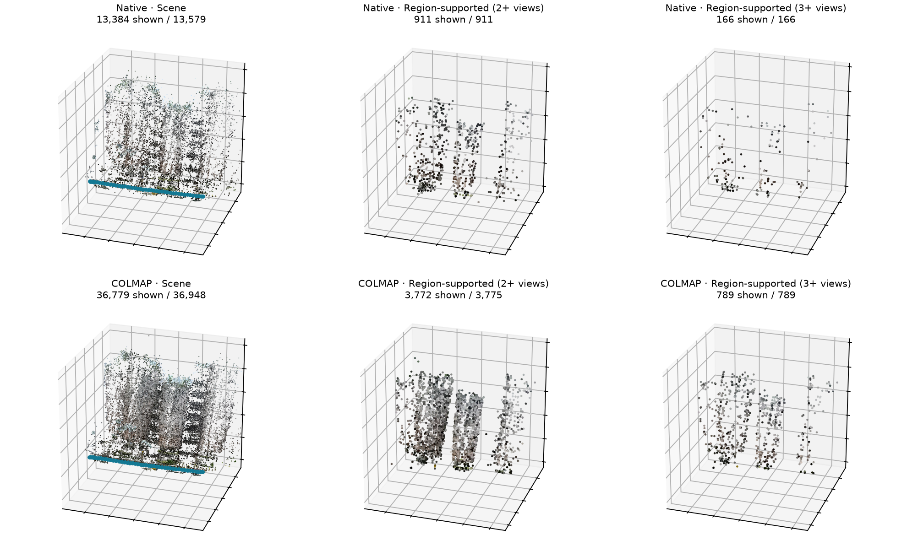

# AI6121 Course Project — Sparse SfM of UOB Innovation Hub

[简体中文](README.zh_.md)

This project reconstructs the sparse 3D structure of the street-facing side of NTU's **UOB Innovation Hub** (formerly The Hive) from a single handheld walking video. The native pipeline automatically samples video frames, extracts and matches SIFT features, estimates camera poses incrementally, triangulates scene points, refines the reconstruction with bundle adjustment, and exports a colored sparse point cloud.

[Source video](data/video/the_hive.mp4) · [Report assets and results](report_reference/RESULTS.md) · [Detailed parameters](docs/SFM_PARAMETERS.md) · [Architecture](docs/SFM_ARCHITECTURE.md)

## Main result

The locked experiment is stored in [`report_reference/results/hive/the_hive_test2`](report_reference/results/hive/the_hive_test2/). It uses [`configs/orbit49_balanced.json`](configs/orbit49_balanced.json) and uniformly samples 49 working images from the approximately 35.76-second, 1,074-frame video.

| Metric | Native SfM result |
|---|---:|
| Working images | 49 at 720 × 1280 |
| Registered views | **49/49** |
| Colored sparse scene points | **13,579** |
| Points with at least five active views | **1,412** |
| Active observations | 38,223 |
| Final reprojection RMSE | **0.655 px** |
| Shared focal length | 832 px initial → 647.53 px estimated |
| Facade-supported points in at least two annotated views | **911** |
| Facade-supported points in at least three annotated views | **166** |

The result supports the following main claim:

> We reconstructed the sparse 3D structure of the street-facing side of UOB Innovation Hub from a single monocular walking video. All 49 working images were registered, and conservative multi-view annotations directly confirm reconstructed points on several cylindrical facade blocks.



## Method overview

```text
Input video
  → orientation-aware frame sampling
  → grid-balanced SIFT and RootSIFT descriptors
  → descriptor matching and geometric verification
  → normalized eight-point initialization
  → incremental PnP camera registration
  → multi-view triangulation
  → robust bundle adjustment and quality filtering
  → colored PLY, camera trajectory, metrics, and diagnostic figures
```

The reconstruction assumes one shared pinhole camera across all frames. Its world coordinate system and scale are arbitrary, as expected for monocular SfM without external metric measurements.

## Environment setup

Use Python 3.11 from the repository root. The automated tests were verified on Windows with Python 3.11.18; the locked experiment records its original platform, dependency versions, source hashes, configuration hash, and random seed in `provenance.json`.

### Linux or macOS

```bash
python -m venv .venv-sfm
. .venv-sfm/bin/activate
python -m pip install --upgrade pip
python -m pip install -r requirements.txt

export OPENBLAS_NUM_THREADS=1
export MPLCONFIGDIR=/tmp/ai6121-mpl
```

### Windows PowerShell

```powershell
py -3.11 -m venv .venv-sfm
.\.venv-sfm\Scripts\Activate.ps1
python -m pip install --upgrade pip
python -m pip install -r requirements.txt

$env:OPENBLAS_NUM_THREADS = "1"
$env:MPLCONFIGDIR = "$env:TEMP\ai6121-mpl"
```

`OPENBLAS_NUM_THREADS=1` is recommended when reproducing CPU timings. `MPLCONFIGDIR` places Matplotlib's cache in a writable temporary directory. Both settings are optional for an ordinary local run.

## Tests

```bash
python -m unittest discover -s tests -v
```

Expected summary:

```text
Ran 6 tests
OK
```

The tests cover the normalized eight-point method, triangulation, outliers and degeneracies, projection and Jacobians, incremental registration, disconnected views, and self-calibration. A saved Python 3.11 test record is available at [`report_reference/test_logs/unit_tests_python311.md`](report_reference/test_logs/unit_tests_python311.md).

## Inspect the input video

```bash
python -m sfm inspect \
  --video data/video/the_hive.mp4 \
  --output outputs/inspection_demo
```

This command samples preview frames and writes:

- `figures/contact_sheet.jpg` — a quick view of sharpness, overlap, and viewpoint changes;
- `frames/` — decoded, orientation-corrected working images;
- `inputs.json` — dimensions, frame rate, duration, source-frame indices, timestamps, and sharpness statistics.

Inspection outputs are diagnostic only and are not consumed by reconstruction.

## Run the native reconstruction

```bash
python -m sfm reconstruct \
  --video data/video/the_hive.mp4 \
  --config configs/orbit49_balanced.json \
  --output outputs/hive_repro
```

The main configuration uses:

- 49 uniformly sampled frames;
- a 5,000-feature budget distributed over a 96 px image grid;
- CLAHE and RootSIFT;
- a three-frame matching window plus configured loop pairs;
- an initial focal length equal to 0.65 times the 1,280 px long image side, i.e. 832 px;
- random seed 6121.

Use a new output directory for each run. Detailed CLI options are documented in [`docs/SFM_PARAMETERS.md`](docs/SFM_PARAMETERS.md).

## Native output files

Each reconstruction directory contains:

- `pointcloud.ply` — the complete colored sparse scene;
- `cameras.json` — per-frame registration status and world-to-camera poses;
- `tracks.json` — feature observations and active/inactive flags;
- `reconstruction.npz` — points, colors, camera poses, and intrinsics for NumPy;
- `metrics.json`, `events.jsonl`, `pairs.json`, `per_view.csv` — matching, registration, filtering, bundle-adjustment, error, and timing records;
- `inputs.json`, `config.resolved.json`, `provenance.json` — input metadata, resolved configuration, versions, hashes, and seed;
- `figures/` — contact sheet, match visualizations, reprojection overlays, error histogram, and scene/camera plots.

`--reuse-appearance <run-dir>` can reuse extracted features and verified image pairs when the input frames and appearance-related configuration are unchanged.

## Facade annotation and independent audit

The manual facade annotations are **evaluation labels only**. They do not influence feature matching, pose estimation, triangulation, bundle adjustment, or the reconstructed point cloud.

Nine representative early, middle, and late views were conservatively annotated. Roads, vegetation, vehicles, lamp posts, columns, uncertain occlusions, and the dark elevator cores were excluded.

To edit or inspect the polygons:

```bash
python experiments/annotate_facade.py \
  --run report_reference/results/hive/the_hive_test2 \
  --output data/evaluation/hive_facade_regions.json
```

To reproduce the audit on the locked result:

```bash
python -m sfm.facade_audit \
  report_reference/results/hive/the_hive_test2 \
  --regions data/evaluation/hive_facade_regions.json \
  --output report_reference/results/hive/the_hive_test2/facade_audit
```

For each reconstructed point, the audit requires both its measured feature location and its final predicted projection to lie inside an eroded facade region. A point is reported only when this condition holds in at least two or at least three annotated views. The final counts are 911 and 166 points, respectively.

Audit artifacts include:

- [`facade_support.jpg`](report_reference/results/hive/the_hive_test2/facade_audit/facade_support.jpg) — image-space regions and confirmed observations;
- [`facade_supported_2plus.ply`](report_reference/results/hive/the_hive_test2/facade_audit/facade_supported_2plus.ply) — the two-view facade subset;
- [`facade_supported_3plus.ply`](report_reference/results/hive/the_hive_test2/facade_audit/facade_supported_3plus.ply) — the stricter three-view subset;
- [`facade_audit.json`](report_reference/results/hive/the_hive_test2/facade_audit/facade_audit.json) — full counts and per-view records.

## External COLMAP baseline

COLMAP is used only as an **external evaluation baseline**. The native SfM pipeline does not call or copy COLMAP, PyCOLMAP, or OpenSfM code.

The controlled baseline uses:

- the same 49 saved PNG working images;
- the same 150 scheduled image pairs;
- one shared `SIMPLE_PINHOLE` camera;
- the same 832 px focal-length initialization;
- the same facade annotations and comparison rules;
- CPU-only PyCOLMAP 4.2.1.

Create a separate environment so that PyCOLMAP does not change the native project's dependencies:

```bash
python -m venv .venv-colmap
. .venv-colmap/bin/activate
python -m pip install --upgrade pip
python -m pip install numpy==2.4.6 pycolmap==4.2.1
```

Run the baseline in a new output directory:

```bash
python experiments/colmap_sparse.py \
  report_reference/results/hive/the_hive_test2 \
  outputs/hive_colmap_same_pairs \
  --same-pairs --focal 832 --threads 4
```

Run the common evaluator from the native SfM environment:

```bash
python experiments/compare_sparse.py \
  report_reference/results/hive/the_hive_test2 \
  data/evaluation/hive_facade_regions.json \
  report_reference/results/hive/colmap_comparison \
  Native=report_reference/results/hive/the_hive_test2 \
  COLMAP=outputs/hive_colmap_same_pairs
```

| Metric | Native | External COLMAP baseline |
|---|---:|---:|
| Registered views | 49/49 | 49/49 |
| Sparse points | 13,579 | 36,948 |
| Reprojection RMSE under the common evaluator | **0.655 px** | 0.858 px |
| Facade points supported in at least two annotated views | 911 | **3,775** |
| Facade points supported in at least three annotated views | 166 | **789** |
| Estimated shared focal length | 647.53 px | 638.13 px |

COLMAP produced denser scene and facade coverage, while the native result has the lower reprojection RMSE under the shared evaluator. Both methods registered all 49 views.



The full command, versions, timing, compact point cloud, and disclosure are preserved in [`BASELINE.md`](report_reference/results/hive/colmap_same_pairs/BASELINE.md). The 86 MB temporary COLMAP feature database is intentionally excluded because it is reproducible and not required by the report bundle.

## Repository structure

```text
.
├── configs/                 # Reproducible SfM configurations
├── data/
│   ├── evaluation/          # Manual evaluation-only region annotations
│   └── video/               # Source videos
├── docs/                    # Parameters, architecture, results, and hand-off notes
├── experiments/             # Annotation, COLMAP, comparison, and ablation tools
├── report/                  # LaTeX report sources
├── report_reference/        # Locked results, report figures, metrics, and test evidence
├── sfm/                     # Native incremental sparse SfM implementation
├── tests/                   # Synthetic geometry and pipeline tests
├── README.md                # English documentation
├── README.zh_.md            # Detailed Chinese documentation
└── requirements.txt         # Native pipeline dependencies
```

## Reproducibility and limitations

- The main result is a sparse reconstruction at an arbitrary scale, not a dense textured building model.
- The walking video covers the street-facing side rather than a complete orbit around the building.
- The relatively narrow street-facing baseline and repeated horizontal facade texture make matching and depth estimation difficult.
- Trees, moving vehicles, lamp posts, self-occlusion, and unobserved rear surfaces limit coverage.
- The facade counts are conservative evidence tied to nine annotated views; they are not the total number of building points.
- The 25-frame default trial registered only 5/25 views. The 49-frame experiment changes both sampling density and feature/pairing parameters, so attributing the improvement to a single change would require an additional ablation.

## Third-party software and AI disclosure

The native implementation uses:

- OpenCV for video/image I/O, image processing, SIFT, descriptor matching, PnP, and Rodrigues conversions;
- NumPy and SciPy for numerical computation and optimization;
- Matplotlib for diagnostic figures;
- PyAV as a fallback for container and orientation metadata.

PyCOLMAP/COLMAP is used only for the separately reported external baseline. OpenSfM is not a runtime dependency and is not used to produce the native result.

OpenAI Codex assisted with code implementation and debugging, synthetic verification, real-data diagnostics, evaluation tooling, figure preparation, and documentation. The final report must disclose the use of generative AI according to the course requirements. All manual facade labels and reported outputs remain inspectable in the repository.

## Report and submission

The LaTeX report sources are in `report/`. Compile locally with:

```bash
cd report
latexmk main.tex
```

Before submission, add all group members' names and matriculation numbers to the cover page, verify every figure/table reference, and include the generative-AI and third-party-software disclosures. The final PDF is submitted through NTULearn.
