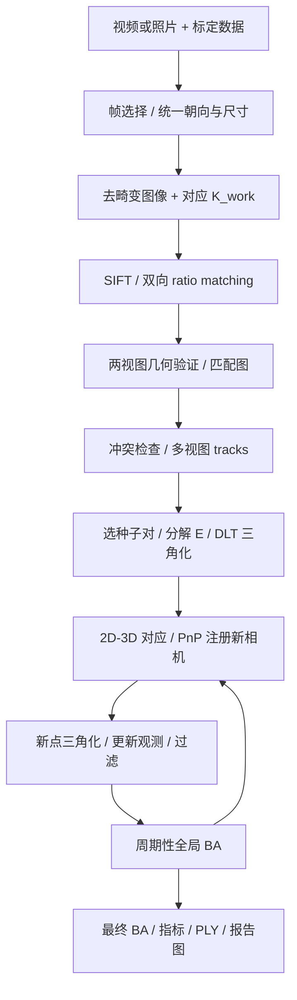

# AI6121 SfM：架构与接口设计

日期：2026-11-18（新加坡时间）。状态：设计已拟定，算法尚未实现，真实数据尚未验证。

本文件规定要做什么和接口；[SFM_AGENT_TASKS.md](SFM_AGENT_TASKS.md)规定执行顺序、分工与验收。需求原文是本地 `docs/SFM .txt`；该原文按现有 Git 规则不提交。

## 1. 已确认的决策与需求边界

用户已选择“改为 SIFT 自动匹配与标定重建”。因此不继续实现报告当前的“25 张照片、8 个手工地标、未知内参的射影重建”主线。25 张仍可作为第一批主要实验的目标数量；8 个地标可用于人工抽查，但不作为自动重建的输入约束。

| 作业原文要求 | 本项目对应交付 |
|---|---|
| 自采 NTU 校园场景，多视图图像或视频恢复三维结构 | Double Helix 视频/照片，自动估计相机与彩色稀疏点云 |
| 可参考开源代码、调用独立函数，不能直接调用完整 SfM | 自己组织匹配、几何、tracks、增量注册与优化；不用 COLMAP mapper、PyCOLMAP mapping、OpenMVG/OpenSfM 完整流水线作为实现 |
| 详细分析、讨论，提交 PDF 与代码 | 可复现实验、消融、失败案例、报告与运行说明 |
| 封面所有组员姓名学号，最多 5 人 | 提交前清单检查；不得编造缺失信息 |
| 2026-11-22 前经 NTULearn 提交 | 内部目标 11 月 21 日完成；原文未给具体截止时刻，需人工核对课程页面 |
| 声明生成式 AI 使用 | 记录架构设计、代码辅助、调试、文字修改等实际用途 |
| 可在新场景评估泛化 | 第二校园场景是扩展项，不作为原文硬性要求 |

这里的自实现边界与验收数值是项目设计，不是老师额外规定。目标是 calibrated incremental sparse SfM：已知内参时恢复欧氏结构至全局相似变换（旋转、平移、统一尺度），没有已知实测距离就不报告米制尺寸。[多视图几何教材导论](https://www.robots.ox.ac.uk/~vgg/hzbook/hzbook2/HZintroduction.pdf)说明了标定信息与重建歧义的关系。

不纳入本次必做：Torch/CUDA、学习型特征、稠密 MVS、网格、NeRF、全局 SfM、自标定、自动物体分割、Web UI。稀疏背景点允许存在，但报告要区分“恢复校园场景”和“恢复雕塑本体”。

## 2. 仓库现状与迁移

已经存在：`data/video/double_helix.mp4`、报告图片、双语 README、LaTeX 报告与参考文献。`data/figures/`、`data/points/` 目前只有占位文件；没有标定文件、已提取图像、运行代码或实测结果。本设计未验证现有视频的镜头、裁切、防抖、清晰度与可重建性。

保留已有视频、照片和报告框架。重写报告的方法、算法与实验部分：删除作为主线的固定 8 点假设、由 F 构造任意射影相机、11 自由度射影相机 DLT、固定 5 个射影参考点的 BA。替换为 SIFT、E 分解、PnP、track 管理和已标定 BA。不要把旧报告里的叙述当成新系统已完成的实验。

## 3. 总体流程



重要区别：新相机通过已有 3D 点做 PnP，继承同一世界坐标与尺度；不能将每对图像单独恢复的单位平移依次相加，不能将多个独立两视图点云直接拼接。

## 4. 技术栈与自主实现范围

以 Python 3.11 为基线，核心依赖为 NumPy、SciPy、opencv-python、Matplotlib；开发依赖 pytest。输出用 ASCII PLY 即可，Open3D 仅作可选查看器；图形界面不可成为 CLI 运行条件。T00 在实际环境安装并锁定验证过的版本，不猜测已测试的版本号，不同时安装多种冲突的 OpenCV wheels。

| 环节 | 实现决策 | 原因与报告披露 |
|---|---|---|
| 视频读取、缩放、标定、去畸变 | 调 OpenCV | 独立的图像/标定操作 |
| SIFT、描述子 KNN 距离 | 调 OpenCV | 不重写特征算法；团队负责匹配策略与诊断 |
| ratio test、双向一致、配对调度 | 自实现 | 明确对应关系如何筛选 |
| normalized eight-point、RANSAC、Sampson error | NumPy 自实现 | 核心几何贡献 |
| E 奇异值约束、4 组 R/t、正深度选择 | NumPy 自实现 | 明确坐标与尺度 |
| DLT 三角化、投影、过滤 | NumPy 自实现 | 核心结构恢复贡献 |
| PnP RANSAC 与姿态细化 | OpenCV 独立函数 | 已知 3D–2D 对应的相机定位；不是整套 SfM |
| tracks、注册调度、重试、状态管理 | 自实现 | 多视图系统的关键工作 |
| BA 残差、变量、尺度约束、稀疏结构 | 自实现，SciPy 做最小二乘求解 | 不调用现成 SfM BA 包装器 |

将 `findEssentialMat`、`recoverPose`、`triangulatePoints` 用作开发阶段对照实现可行，但必须与主路径分离、标明来源，不能悄悄替代规定的自实现模块。参考开源片段时记录 URL、许可证、修改内容。PnP 的调用边界是本组的实施选择，并非已获授课老师单独确认。

## 5. 数据与坐标契约（T00 后冻结）

### 5.1 文件组织

```text
configs/default.json
src/sfm/
  __init__.py  __main__.py  cli.py  types.py  config.py
  io.py  calibration.py  preprocessing.py  features.py  matching.py
  geometry.py  tracks.py  initialization.py  registration.py
  triangulation.py  bundle_adjustment.py  reconstruction.py
  metrics.py  visualization.py  export.py
tests/
  synthetic.py  test_geometry.py  test_tracks.py
  test_reconstruction.py  test_bundle_adjustment.py
data/
  video/                  # 现有原视频，不覆盖
  calibration/            # 标定板照片、camera.json、质量记录
  figures/                # 抽帧后的原始选定图像
  scenes/double_helix.json # scene manifest
  points/                 # 原有目录保留；人工地标仅可选检查
outputs/<run_id>/
  config.resolved.json  provenance.json  events.jsonl
  cache/  reconstruction.npz  cameras.json  tracks.json
  pointcloud.ply  metrics.json  per_view.csv  figures/
pyproject.toml
requirements.lock.txt
```

生成数据、缓存和运行输出默认不提交；配置、小型合成 fixtures、报告选用图及实验汇总可提交。实现 agent 调整 `.gitignore` 时保留本次两个设计文档的例外；不得覆盖或删除输入视频。`run_id` 唯一，已有输出目录默认报错，覆盖需显式参数。

### 5.2 一套几何坐标，禁止混用

- 图像数组为 `[v,u]`，点坐标为 `(u,v)`；左上角像素中心为 `(0,0)`，u 向右、v 向下，单位 pixel。
- 核心模块只处理“已统一朝向、缩放、去畸变”的工作图像。SIFT、匹配、颜色采样、BA、指标均对应这个工作图像。
- 每张图保存原始尺寸、实际变换、工作尺寸与 `K_work`；简单缩放是 `K_scaled = diag(sx,sy,1) @ K_original`。若裁切须相应平移主点。尽量不裁切去畸变结果，仅屏蔽无效边缘。
- 去畸变输出使用指定的新内参矩阵，后续畸变系数恒为 0；不重复去畸变。原视频的防抖变形不能当作静态镜头畸变处理。
- 归一化相机点 `x = (K_work^-1 @ [u,v,1])[:2]`，只在算法内部使用；Sampson/PnP/重投影阈值对外一律以工作图像 pixel 表示。
- `X_cam = R_cw @ X_world + t_cw`，`P = K_work @ [R_cw | t_cw]`，相机中心 `C_world = -R_cw.T @ t_cw`。相机前方 z > 0。
- 种子第一相机 `R=I,t=0`，第二相机初始 `||t||=1`。所有后续相机沿用此坐标系，尺度单位是任意单位。
- 几何一律 float64；SIFT 描述子 float32；索引 int64；mask bool。所有函数校验形状、有限性和匹配索引范围。

OpenCV 的[标定与三维重建文档](https://docs.opencv.org/4.x/d9/d0c/group__calib3d.html)可核对投影约定和独立函数参数；实际实现须为上述项目契约写验证。

### 5.3 核心记录

下面是待实现的 Python 数据结构契约，不是已存在的代码。

| 类型 | 必需字段 / 不变量 |
|---|---|
| `Frame` | `image_id:int, path, source_index, timestamp_s?, width, height, K:(3,3), camera_id, input_hash`；ID 按 manifest 稳定分配，不由目录遍历顺序决定 |
| `Features` | `image_id, xy:(N,2), descriptors:(N,128), rgb:(N,3) uint8`；keypoint_id 是本数组行号，缓存后不重排 |
| `PairMatches` | `i,j, indices:(L,2), distances:(L,), ratio_scores:(L,)`；每个方向均一对一；约定 i < j |
| `VerifiedPair` | 原始 matches、`inlier_mask:(L,), E:(3,3), F:(3,3), sampson_px2:(L,), status, diagnostics`；mask 始终映射原匹配顺序 |
| `Observation` | `(image_id,keypoint_id)` 唯一标识；xy 通过 Features 获取，不重复持有可漂移副本 |
| `Track` | `track_id, observations:{image_id:keypoint_id}`；每图最多一个观测；可暂时没有 3D 点 |
| `CameraPose` | `image_id,R_cw:(3,3),t_cw:(3,),registered`；已注册旋转需满足 SO(3) |
| `Point3D` | `point_id,track_id,xyz:(3,),rgb:(3,),active_observations,status`；一个 track 最多一个有效 3D 点 |
| `Reconstruction` | frames、features 引用、tracks、poses、points、seed_pair、状态/失败原因、BA 历史 |

主接口固定为：

```python
load_scene(manifest_path) -> Scene
prepare_frames(scene, cfg, output_dir) -> list[Frame]
extract_features(frame, cfg) -> Features
match_pair(fi, fj, cfg) -> PairMatches
verify_pair(matches, fi, fj, Ki, Kj, cfg, rng) -> VerifiedPair
build_tracks(verified_pairs, cfg) -> TrackGraph
initialize(frames, features, graph, verified_pairs, cfg) -> Reconstruction
register_image(state, image_id, cfg, rng) -> RegistrationResult
triangulate_track(state, track_id, cfg) -> TriangulationResult
bundle_adjust(state, cfg) -> BAResult
run_reconstruction(scene, cfg, output_dir) -> RunResult
evaluate(state, cfg) -> Metrics
export_run(state, metrics, output_dir) -> None
```

底层纯函数：`normalize_points_2d`、`eight_point`、`sampson_error_px2`、`decompose_essential`、`project_points`、`triangulate_dlt`。估计器返回状态与诊断，不以空矩阵冒充成功；只有输入格式错误抛异常。所有随机源由 run seed 派生。

## 6. 各阶段的具体设计

### 6.1 标定与输入准备（A；数据成员协助）

1. 优先使用同一镜头、同一分辨率/裁切模式的照片或视频，固定焦距与变焦，尽量锁焦和曝光。手持要有平移、重叠，不只站在原地转手机。
2. 获取约 15–25 张不同位置、角度、覆盖画面各区域的棋盘格照片，记录内角点行列数、格子尺寸、镜头/模式信息。调用角点检测、亚像素细化、`calibrateCamera`，保存 K、dist、图像尺寸、总 RMS 与每图误差，人工检查异常视图。这些数量是采集建议。
3. 手机视频的数码防抖、动态裁切、自动切换镜头可能导致 K 不一致。数据诊断记录是否开启；不能因同一手机就默认标定适用。现有视频不匹配时优先重拍短序列。
4. 初次抽取约 25 帧，工作图像长边不超过 1600；保存源帧编号/时间与缩放。输出 contact sheet 与清晰度统计供选择，模糊阈值先只诊断，避免未经验证地删掉大量帧。
5. 无标定时照常完成合成测试、抽帧和特征匹配。默认正式重建拒绝缺失 K；可显式启用 `--allow-approx-intrinsics` 诊断模式，记录假设与敏感性，不称为 calibrated 主结果。不得编造标定数据或用网络常见焦距冒充实测。

标定板不是场景绝对尺度来源：它用于求内参，不会自动让另一个场景的 SfM 点云具有米制尺度。

### 6.2 SIFT 与匹配（A）

`SIFT_create(nfeatures=4000)` 起步；RGB/BGR 转换明确。KNN k=2，L2 距离，双向 ratio < 0.75，再保留相互一致的匹配；不足两个近邻时跳过，不索引越界。参考[OpenCV SIFT 教程](https://docs.opencv.org/4.x/da/df5/tutorial_py_sift_intro.html)。

有时间顺序的图像优先匹配 `0 < j-i <= 5`；对 25 帧成本仍小。若匹配图断开，再扩展未匹配的较远候选；所有图对去重，默认不无条件全连接。保存每对原始、ratio 后、几何内点的数量与可视化。无时间顺序照片允许配置 exhaustive 配对。

### 6.3 自实现两视图几何（B）

1. 将工作像素经各自 K 变成归一化相机坐标，再对两组点分别做 Hartley 平移/缩放（平均距离为 sqrt(2)）。
2. 用 `x2.T @ E @ x1 = 0` 的行优先向量化构造 8 点矩阵：`[x2*x1, x2*y1, x2, y2*x1, y2*y1, y2, x1, y1, 1]`。SVD 后 `reshape(3,3, order='C')`，不能照搬旧报告列优先 reshape。
3. 在 Hartley 坐标拟合 rank-2 矩阵，反归一化回相机归一化坐标后投影到 essential manifold：奇异值改为 `(s,s,0)`，s 为前两者均值。注意 8×9 的最小矩阵必须取得完整右零空间；`full_matrices=False` 会丢掉所需第九个右奇异向量。
4. 将候选 E 转成 `F = inv(Kj).T @ E @ inv(Ki)`，在工作像素上评分：

   `d² = (u2.T F u1)² / ((F u1)[0]² + (F u1)[1]² + (F.T u2)[0]² + (F.T u2)[1]²)`。

   分母近零标为无效；`d² < threshold_px²` 为内点。不要把归一化坐标残差直接与 pixel 阈值比较。
5. 自实现 8 点 RANSAC，置信度 0.999、上限 5000 次；按当前内点比例 w 用 `log(1-p)/log(1-w**8)` 更新预算并做边界保护。跳过重复、近共线、秩不足样本。低内点率时预算可能不足，应返回失败诊断，不宣称数学保证。
6. 最优模型按内点数、内点中位误差排序；用所有内点重新拟合，再重新计算 mask，有限轮迭代。RANSAC mask 和后续正深度 mask 必须通过原索引组合。
7. 从 E 的 SVD 得 4 组 `(R, ±t)`，修正 det(R)=+1，DLT 三角化并计数两相机正深度；同时检验重投影和视差，不能仅看正深度数量。

用 homography RANSAC 作为平面/纯旋转诊断辅助（可调库）。H 内点多本身不是硬拒绝依据；若 H 占优且三角化视差不足，则不选作种子。退化情况必须被记录，不能调松阈值制造点云。

### 6.4 Tracks（A）与种子选择（B）

Tracks 由几何内点边连接 `(image_id,keypoint_id)` 节点。按稳定的“几何残差、匹配距离、节点 ID”顺序合并；若两个连通分量包含同图不同 keypoint，拒绝这条边并记录冲突。只连接几何验证过的边；仅有 union-find 而不检查同图冲突不合格。

Track 是候选对应链，不保证所有观测都正确。后续三角化/PnP/BA 可将单个观测标为 inactive，但不重编号、不永久删除原始对应。第一版冻结 tracks；不需要实现在线轨迹合并。

种子从匹配图最大连通分量中选：先按几何内点数取最多 20 对候选，再做 E 分解、三角化与视差检查。通过者按有效 3D 点数降序、视差中位数降序、重投影中位数升序、图像 ID 排序。保存全部候选及拒绝原因。若全失败，终止为 `no_valid_seed`，输出诊断而非空的成功结果。

### 6.5 增量注册（B 负责姿态，C 负责主循环）

每轮对未注册图像统计其 tracks 中已有有效 3D 点的数量，按数量优先、ID 打破并列。通过 track_id 找 3D–2D 对应，一图同一 3D 点最多使用一次。

使用工作像素、K_work、零畸变调用 `solvePnPRansac`（EPNP 初始化），再对内点做姿态细化；检查内点数、内点比例、像素残差、正深度比例。失败不能覆盖已有状态；记录拒绝原因并尝试下一图。

新图成功后：检查其对已有点的新观测；给无点但至少两个已注册观测的 tracks 三角化；更新点/观测有效性。每新增 5 个相机或注册停滞时全局 BA（同一状态至多做一次停滞 BA），然后重试失败视图。整轮无进展且 BA 后仍无进展则停止；每图最多 3 次注册尝试，只有地图变化才重试。不无限循环，不静默丢弃未注册图像。

最大连通分量之外的图像列为 `disconnected`。首版不做独立子图重建与融合；不能把多个独立尺度的子图放入同一 PLY。

### 6.6 三角化与点过滤（C）

使用 `x = K^-1 u` 与 `[R|t]` 构造 DLT：每个观测两行 `x*P[2]-P[0]`、`y*P[2]-P[1]`。至少两个观测。先在已注册观测中选视线夹角较好的相机对初始化，检查齐次 w、有限性、正深度、重投影，再用有效的全部视图重三角化/优化该点。

视差用世界坐标单位视线或相机中心到点的向量夹角计算。几乎零基线、过小夹角或无穷远点拒绝。已有 3D 点的新观测只在投影一致时激活；错误观测不会因为同属一个 track 自动加入 BA。点最终需至少两个有效观测，颜色取有效观测 RGB 中位数。不得按“看起来像雕塑”随意手工删除点后隐瞒。

### 6.7 Bundle Adjustment（C）

优化所有已注册相机外参和有效 3D 点；固定 K 与畸变。每个相机旋转用 3 维 rotation vector，平移 3 维，每点 3 维。目标是工作像素上的重投影残差，默认 Huber loss，`f_scale=2.0`。自行生成 residual vector 和 jac_sparsity，调用 SciPy `least_squares(method='trf', x_scale='jac')`；每个像素残差只依赖一个相机与一个点。[SciPy 文档](https://docs.scipy.org/doc/scipy/reference/generated/scipy.optimize.least_squares.html)说明了这些优化接口。

消除 7 个相似变换自由度：固定第一种子相机的全部 6 个参数；从第二种子平移中选初始绝对值最大的一个分量，固定为其初始非零值，其余分量可优化。不要同时固定第二相机整个位姿，也不要沿用旧报告的 5 点射影约束。固定量从优化向量移除，不能靠任意正则化冒充 gauge fixing。

起始观测集需有限且正深度。残差函数对试探点接近 z=0 的情况用有限安全除法并提供深度违规惩罚，保持残差长度固定；保存像素误差与惩罚各自指标。最终候选必须满足深度和有限性检查。实现可设置安全的小步重启，但不得在函数内部改变 active mask 或用 NaN 继续求解。

优化结束先比较同一观测集、同一损失定义的目标；不接受更差或非有限解，失败保留输入状态并记录 solver status/message。然后可执行一次有记录的 outlier filtering 与再优化。分别报告固定观测集上的前后变化，以及过滤后统计；Huber 成本下降并不保证普通 RMSE 下降。最终 BA 必做；无 BA 模式仅用于消融。

第一版使用周期性全局 BA，不引入滑窗/局部 BA，以免新增边界相机与尺度约束错误。若性能不足先降低输入规模、重复帧与冗余特征，保存完整调整记录。

## 7. 初始配置与失败策略

以下全部是可调整的工程初值，不是作业评分标准或已测结果。调整必须通过配置并记入输出。

```json
{
  "seed": 6121,
  "preprocess": {"target_frames": 25, "max_long_edge": 1600},
  "features": {"method": "sift", "max_features": 4000},
  "matching": {"strategy": "sequential", "window": 5, "ratio": 0.75, "mutual": true},
  "geometry": {"sampson_threshold_px": 1.5, "confidence": 0.999, "max_trials": 5000, "min_inliers": 30},
  "initialization": {"max_candidates": 20, "min_points": 30, "min_median_angle_deg": 1.5, "min_positive_depth_ratio": 0.9},
  "registration": {"min_correspondences": 20, "min_inliers": 15, "min_inlier_ratio": 0.5, "threshold_px": 3.0, "max_attempts": 3},
  "triangulation": {"min_angle_deg": 1.0, "max_reprojection_px": 3.0, "min_observations": 2},
  "ba": {"enabled": true, "every_n_cameras": 5, "loss": "huber", "f_scale_px": 2.0, "max_nfev": 100}
}
```

必须区分：`invalid_input`、`missing_calibration`、`insufficient_matches`、`degenerate_geometry`、`no_valid_seed`、`pnp_failed`、`ba_failed`、`disconnected`、`partial`、`success`。记录受影响图像/图对、实际统计、阈值与处理决定。数据或种子失败退出码非零；只完成部分相机也须由 CLI 清楚标识，不把“写出 PLY”当作完整成功。

缓存键至少包含输入文件 hash、尺寸/去畸变参数、相机标定 hash、特征配置、实现版本。匹配/几何缓存进一步包含上游缓存键及相应配置。不要改了 K 或 ratio 后仍用旧 mask。

## 8. 运行接口与输出契约

待实现命令示例（当前尚不可运行）：

```bash
python -m sfm calibrate --images data/calibration/images --board-cols 9 --board-rows 6 --square-size 0.025 --output data/calibration/camera.json
python -m sfm prepare --video data/video/double_helix.mp4 --camera data/calibration/camera.json --config configs/default.json --scene-out data/scenes/double_helix.json
python -m sfm inspect --scene data/scenes/double_helix.json --config configs/default.json --output outputs/inspection
python -m sfm reconstruct --scene data/scenes/double_helix.json --config configs/default.json --output outputs/main
python -m sfm evaluate --run outputs/main
python -m pytest
```

示例棋盘尺寸只是 CLI 演示，实际命令须用真实棋盘内角点数与格长。`inspect` 还应支持未标定原图的匹配诊断；不得把那部分输出当作去畸变后的几何结果。

- `scene.json`：`schema_version`、scene_id、camera 记录、输入顺序与路径、每帧来源、是否近似内参。相对路径以 manifest 所在目录解析，不依赖当前 shell 目录。
- `reconstruction.npz`：image_ids、R_cw、t_cw、K_work、point_ids、track_ids、xyz、RGB；不依赖 pickle。
- `tracks.json`：每个 track 的观测及 active 状态；明确 keypoint cache 路径/版本。
- `cameras.json`：每图注册状态、R/t、相机中心、K、失败原因；JSON 不允许 NaN，缺失值用 null。
- `metrics.json`：总/注册图像数、配对与内点统计、点数、track 长度、重投影分布、BA 前后、阶段耗时、警告、内参来源。
- `figures/`：输入 contact sheet、三组匹配前后图、重投影叠加图、误差直方图、相机轨迹与点云多角度图、失败示例。
- `provenance.json`：Git commit + dirty 状态、Python/依赖版本、输入 hash、完整配置 hash、随机种子、操作系统、运行时间；本机无法采集的硬件字段写 unknown。

## 9. 验收、实验与结论边界

### 9.1 分层验收

1. **数学验证**：固定种子的合成非共面场景，相机与 3D GT 已知；无噪声投影/三角化误差接近双精度精度，在条件良好的 fixture 上 pixel 误差 < 1e-6。旋转误差、平移方向误差可设 < 1e-3 rad。另测 8 点最小样本、噪声与外点、平面、纯旋转、重复点、无特征。
2. **两视图里程碑**：真实标定图像有足够匹配、正深度点、合理视差；输出 R/t、点云与投影叠加。它不是完整项目终点。
3. **多视图最低工程验收**：至少 5 个真实视图在同一坐标系成功注册，存在跨 3 个以上视图的 tracks，完成最终 BA，所有被接受点和位姿有限且满足过滤规则，运行可复现。
4. **主要实验目标**：约 25 帧，注册率目标 >=80%，有效稀疏点目标 >=200，主要内点误差中位数目标 <=2 px。达不到时提供原因、原始数值与改进证据；这些指标不是承诺，更不能以删图/删点改变分母后冒充达到。
5. **课程交付**：完整代码、依赖、输入准备说明、指标与图表、PDF、成员信息、AI 声明。PDF 与源码中的方法必须一致。

### 9.2 最小实验矩阵

| 实验 | 控制变量 | 必须记录 |
|---|---|---|
| 主结果 | 固定清晰帧、已标定内参、完整流程 | 注册数/总数、点数、track 长度、误差、时间、点云与相机 |
| BA 消融 | 从同一初始化 checkpoint 分支，无 BA / 有 BA | 同一观测集误差与 robust cost，过滤前后数目 |
| 采样密度 | 同一段时间范围、同一分辨率，约 10/25/50 帧（数据足够时） | 注册率、有效点、匹配成本、视差与失败原因 |
| 故障分析 | 至少一个真实困难图对/序列 | 模糊、重复结构、反光、低视差、背景主导等有证据的分析 |
| 可选泛化 | 新场景，固定主配置 | 相同指标、失效原因，不只展示最好点云 |

在无 3D GT 的实拍场景，重投影误差是内部一致性，不能证明绝对三维准确。不能报告凭空的 Chamfer distance、厘米精度或“恢复完整表面”。合成测试如比较 3D 误差，应在相似变换对齐后计算，并明确这是合成数据。

可选 held-out 验证：对已有至少 3 个训练观测的 track，预先留出一个非种子观测，完全不参与初始化、PnP、三角化、BA 和参数选择，只做最终投影误差；确保对应相机仍可由其他训练点注册。若无法保证隔离则只报训练残差，不能称测试误差。

## 10. 人员职责与学习成果

三位代码成员按以下分工即可并行工作；人名尚未提供，不推定用户一定负责 B。

| 成员 | 独立负责的代码 | 必须能解释/验证 |
|---|---|---|
| A：数据与对应关系 | 标定工具、预处理、SIFT、matching、tracks | 缩放为什么要改 K；ratio 如何影响错配；同图冲突为何不能合并 |
| B：相机几何 | 8 点 + RANSAC、E 分解、初始化、PnP 注册 | E 的约束；4 组解如何选；纯旋转为什么失败；为何用 PnP 保持尺度 |
| C：结构与系统 | DLT、过滤、BA、重建主循环、导出与指标 | 三角化条件；重投影误差；BA 的 gauge；多视图为什么不是拼点云 |

A/B/C 均使用同一合成 fixture，可以不等前一模块完成就开始。C 为集成负责人，不表示其独自承担所有报告与实验。若团队确有另两名成员，分别负责实拍/标定/数据记录，以及实验复核/文献/报告整合；若只有三人，这些工作需三人共同覆盖。

Agent 可以实现明确模块、生成合成测试、诊断 bug，但每个负责人须运行自己的测试，修改至少一个参数并解释结果，能画出输入输出与失败路径。每个模块附简短 `docs/learning/<module>.md` 作为后续产物：数学概念、关键代码位置、一项实验、一项失败案例、三道自测问题。不能以“AI 写的所以不知道”为结束。

## 11. 关键资料

以下是实现核对材料，不授权复制整套 pipeline；外部工具的当前版本行为仍须以安装环境为准。

- [OpenCV 标定、投影与 PnP](https://docs.opencv.org/4.x/d9/d0c/group__calib3d.html)
- [OpenCV SIFT 教程](https://docs.opencv.org/4.x/da/df5/tutorial_py_sift_intro.html)
- [SciPy least_squares](https://docs.scipy.org/doc/scipy/reference/generated/scipy.optimize.least_squares.html)
- [Hartley–Zisserman 教材导论](https://www.robots.ox.ac.uk/~vgg/hzbook/hzbook2/HZintroduction.pdf)
- 仓库 `report/references.bib` 的多视图几何、eight-point、SfM 与 BA 文献；报告更新时逐条确认实际使用和引用，不把旧文献列表当成已经阅读。
